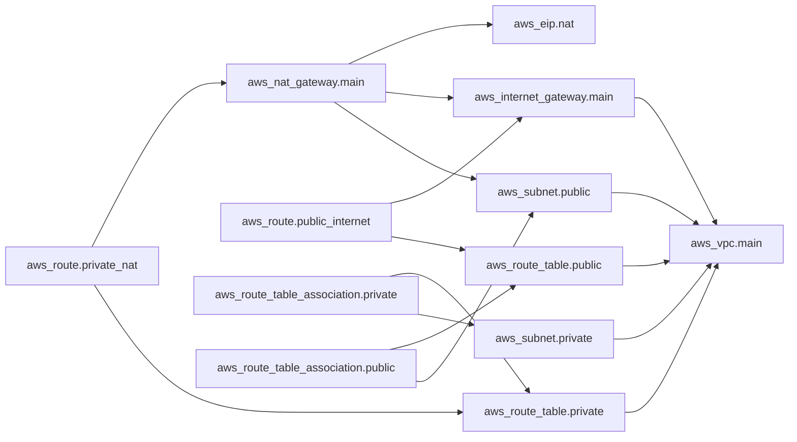

# Demo Terraform Module

This module is a fixture for exercising `tf-doc-gen`; it is not intended to be deployed as-is. It describes AWS infrastructure, including a NAT Gateway and Elastic IP, which can incur ongoing charges. Do not run `terraform apply` unless you have reviewed the configuration and intend to create and pay for those resources.

<!-- tf-doc-gen:start -->
# Terraform Module Documentation

Generated by `tf-doc-gen`. Update the source Terraform files and rerun the generator.

## Inputs
| Name | Description | Type | Required | Default |
| --- | --- | --- | --- | --- |
| `availability_zone` | Availability zone for the public and private subnets. | `string` | Yes | - |
| `aws_region` | AWS region where the network is created. | `string` | No | `us-east-1` |
| `name` | Prefix used for resource names and tags. | `string` | Yes | - |
| `private_subnet_cidr` | IPv4 CIDR range for the private subnet. | `string` | No | `10.40.2.0/24` |
| `public_subnet_cidr` | IPv4 CIDR range for the public subnet. | `string` | No | `10.40.1.0/24` |
| `vpc_cidr` | IPv4 CIDR range for the VPC. | `string` | No | `10.40.0.0/16` |

## Outputs
| Name | Description | Sensitive |
| --- | --- | --- |
| `nat_gateway_id` | ID of the NAT gateway serving the private subnet. | No |
| `private_subnet_id` | ID of the private subnet. | No |
| `public_subnet_id` | ID of the public subnet. | No |
| `vpc_id` | ID of the created VPC. | No |

## Examples
```hcl
module "example" {
  source = "./"

  # TODO: provide a value for required input `availability_zone`
  # TODO: provide a value for required input `name`
}
```

Example configurations:
- [`examples/basic/main.tf`](examples/basic/main.tf)

## Architecture Diagram


## Version Compatibility
- Terraform: `>= 1.5.0`
- Provider `aws`: source `hashicorp/aws`, version `~> 5.0`

## Breaking Changes
Breaking changes cannot be inferred reliably from Terraform source. Record versioned migration notes in a `CHANGELOG.md` and review them when upgrading this module.
<!-- tf-doc-gen:end -->
